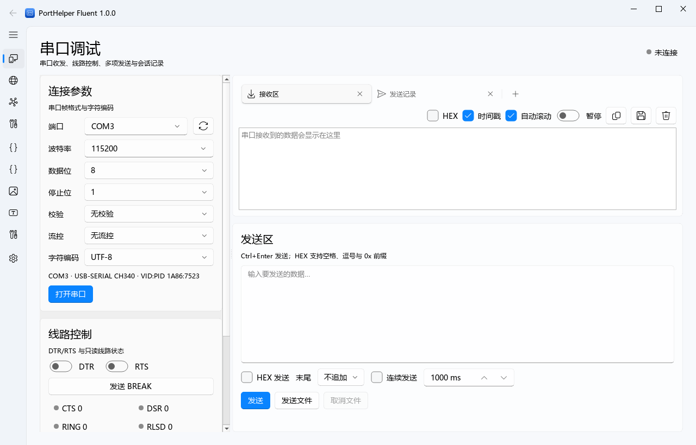
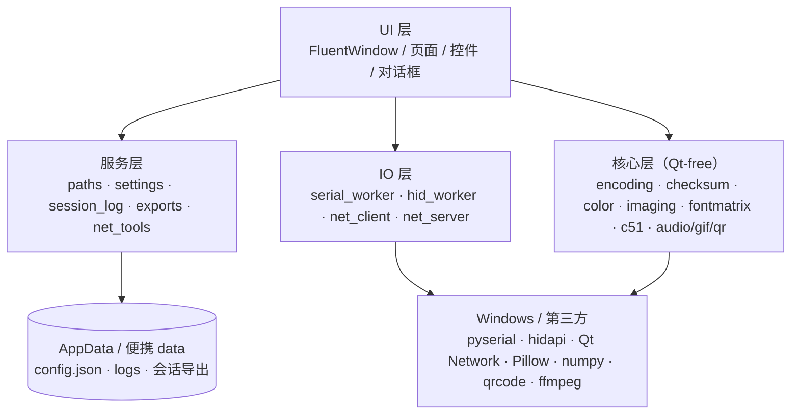

<div align="center">
  
  <h1>PortHelper Fluent</h1>
  <p>Windows 11 风格的单片机多功能调试助手<br>Python + PyQt6 + PyQt6-Fluent-Widgets</p>

  
  
  
  
  
</div>

> 功能参考 **PortHelper 1.8.8**（作者：温子祺）。本项目是独立的 Python 复刻，不包含原程序的代码、图标、截图、驱动或蓝牙助手组件；原程序版权仍归原作者所有。详见 [逆向工程说明](docs/REVERSE_ENGINEERING.md)。



*界面示意图（浅色主题、离屏渲染）。实际运行时会尝试启用 Mica，失败时自动降级；最终效果以本机为准。*

## 为什么做这个

原版 PortHelper 是很多嵌入式开发者熟悉的调试工具，但它基于较旧的 MFC 界面，部分功能依赖 32 位驱动、厂商 DLL 或外部蓝牙助手。本项目保留日常高频能力，用现代 Fluent / WinUI 风格控件重组界面，并让串口、网络、HID、校验、C51、图片/点阵工具在同一个 Windows 11 应用中完成。

项目目标：

- 常用功能齐全，不为了“复刻”而把不可移植的驱动/外部程序硬塞进来。
- 每个页面都能独立使用，参数自动保存，错误提示可读。
- 单文件 exe，无需安装器、无需管理员权限、不写注册表。
- 算法、IO、界面分层，核心逻辑可单测。

## 功能总览

| 页面 | 主要能力 |
| --- | --- |
| 串口调试 | 串口枚举与描述、波特率/数据位/停止位/校验/流控/编码、DTR/RTS/BREAK、CTS/DSR/RING/RLSD、文本/HEX、时间戳、暂停、连续发送、文件发送、多项发送、会话记录与 TXT/CSV 导出 |
| 网络调试 | TCP 客户端、UDP、目标 IP/域名、源/目的端口、Ping、域名转 IP、网卡信息（含默认网关）、文本/HEX、连续/文件发送、TCP/UDP 会话记录 |
| 网络服务器 | TCP 监听、客户端列表、按客户端发送、广播、断开客户端、收发计数、会话导出 |
| USB HID | 标准 HID 设备枚举与过滤、VID/PID/产品名/Usage、报告 ID/长度、读写、连续/文件发送、接收记录；CH372 不在支持范围 |
| 校验计算 | Sum-8/16/32、XOR/BCC、奇偶校验、Intel HEX、TCP/IP、CRC-8/16/32 常用预设、自定义 CRC、取反、大小端显示、文件流式计算与源码预览 |
| 编码转换 | 2–36 进制、Bin/Hex/Text 互转、七段数码管、调色板（RGB565/RGB332）、GIF→BMP、音频→C、二维码 |
| 图片取模 | 图片→C/BIN/LVGL8/LVGL9、水平/垂直扫描、四种方向、1/8/16/24/32 位、大小端、缩放、1 位阈值、批量导出 |
| 点阵生成 | 文字/BMP 取模、系统字体、粗体/斜体、扫描/走向/位序、分页、单元格编辑、C/BIN 导出、BMP 文件夹批量 |
| C51 向导 | 晶振/6T/12T、P0–P3、外部中断/定时器/串口中断、定时器 0–2、波特率、SMOD、功耗模式、软件延时、警告、C 与 Keil 工程导出 |
| 设置与关于 | 主题/强调色、默认编码、日志显示、路径、配置导出/重置、在线更新、支持范围与致谢 |

## 界面与交互

- `FluentWindow` 侧边导航，分为「通信 / 工具 / 其他」三组。
- 跟随系统、浅色、深色三种主题，强调色可配置；Mica 不可用时自动降级。
- 收发区使用等宽字体、HEX/时间戳/暂停/自动滚动/导出；日志批量刷新，避免高速数据卡 UI。
- 所有 Qt 槽函数经过 `safe_slot` 兜底，异常转为中文提示与日志，不让未捕获异常导致进程静默退出。
- 常用参数、窗口尺寸、最近目录按页面保存；配置文件损坏会备份后回退默认值。

## 快捷键

| 快捷键 | 作用 |
| --- | --- |
| `Ctrl+Enter` / `Ctrl+Return` | 在当前发送框发送（串口/网络页面） |
| `Ctrl+K` | 清空当前日志面板 |
| `Ctrl+S` | 保存当前日志/导出当前结果（页面相关） |
| `F5` | 刷新串口、设备或适配器列表 |

## 快速开始

### 直接运行已构建的 exe

仓库**不提交**约 60 MB 的二进制文件，避免仓库膨胀。若已有本地构建产物：

```text
dist\PortHelperFluent.exe
```

双击即可运行，无需安装、无需管理员权限。配置与日志默认位于：

```text
%APPDATA%\PortHelperFluent\config.json
%APPDATA%\PortHelperFluent\logs\app.log
```

把 `portable.flag` 放在 exe 同目录可切换便携模式，配置与日志写入 `data\`；写入失败会回退 AppData 并提示。

隐藏自检入口：

```bat
PortHelperFluent.exe --selftest --report selftest.json
PortHelperFluent.exe --smoke-test
```

### 从源码运行

要求 Windows 10/11、Python 3.13（本项目在 3.13.9 验证）：

```bash
python -m pip install -r requirements.txt
python main.py
```

可选安装 ffmpeg 并加入 PATH，用于「音频→C」的 MP3 解码；不安装时仍支持 WAV。

### 构建单文件 exe

```powershell
powershell -ExecutionPolicy Bypass -File build/build.ps1
```

脚本会依次：

1. 运行全量测试；
2. 重新生成应用图标；
3. 用 PyInstaller 构建单文件窗口程序；
4. 从独立临时目录执行 `--selftest` 与 `--smoke-test`；
5. 生成 `dist/SHA256.txt` 与 `dist/build.log`。

产物：`dist\PortHelperFluent.exe`。构建细节见 [构建指南](docs/BUILDING.md)。

## 在线更新

程序内置更新器，只从本项目的 GitHub Releases 获取新版本：

- **来源**：`https://github.com/Yaopyr/PortHelperFluent/releases/latest`（只认正式 Release，draft/prerelease 不参与）。
- **校验**：只允许 https 且主机在 GitHub 白名单内（重定向后的最终地址再校验一次）；下载优先用 Release 元数据的 `sha256:` digest，缺失时下载 `SHA256.txt`，哈希不符立即删除文件并中止。
- **文件位置**：下载包、`.part` 临时文件、旧版本备份、`apply-update.ps1` 与 `update.log` 都在 `%APPDATA%\PortHelperFluent\updates`——不会在 exe 所在目录（如桌面）留下文件（可写性探针只在目录内短暂创建后立即删除）。便携模式（`portable.flag`）下落在 `data\updates`。
- **安装**：确认后程序关闭（跳过退出确认，仍停止串口/网络/HID 等后台任务），由 PowerShell 脚本等待进程退出、替换 exe 并自动重启；失败写 `update.log` 并用备份回滚。
- **触发**：启动 1.5 秒后静默检查一次，发现新版本时右上角提示；「设置 → 更新」可手动检查、「下载并安装」，也可用「启动时检查」开关关闭启动检查（关闭后启动时不再检查，手动检查仍可用）。
- **源码运行**：`python main.py` 只检查与下载，不替换文件，按提示手动替换打包后的 exe；程序目录不可写（如 `Program Files`）时同样只提示已下载路径。

## 项目结构

```text
porthelper-fluent/
├─ app/
│  ├─ core/        # 纯 Python 算法：校验、编码、图像、字模、C51、配置、日志
│  ├─ io/          # 串口/HID 工作线程、TCP/UDP 客户端、TCP 服务端
│  ├─ services/    # 路径、导出、会话记录、Ping/DNS/网卡、在线更新（updates · updater_install）
│  └─ ui/          # Fluent 窗口、页面、通用控件、对话框、主题、统一布局容器
├─ analysis/       # 逆向文字证据与解析脚本（原始二进制/图片资源不提交）
├─ build/          # PyInstaller spec、构建脚本、图标、版本信息
├─ docs/           # 架构、构建、使用、逆向说明、设计规格与实施计划
├─ tests/          # pytest 测试（683 项）
├─ main.py         # 应用入口与自检
├─ requirements.txt
└─ pytest.ini
```

## 架构



- 串口与 HID 各用一个 `QThread`：读循环 50 ms 超时，写队列与线路控制命令在同一线程顺序执行；串口文件发送按真实写入确认推进，避免无界排队。
- 网络使用 `QTcpSocket` / `QTcpServer` / `QUdpSocket`，在 Qt 事件循环内运行；UDP 域名解析异步排队，陈旧回调不会串包。
- 日志先进入 `SessionLog`，界面按 33 ms 批次渲染；显示区有上限，完整会话保留到 8 MB，截断时界面与 TXT 导出会提示。
- 校验文件模式使用 `QThreadPool` 流式读取；图片/点阵批量与音频解码目前仍在 GUI 线程，超大文件可能短暂卡顿（已知限制）。
- 打包使用 PyInstaller onefile，排除 PyQt5、WebEngine、Quick/QML、3D、Multimedia 等未使用模块。
- 侧边导航折叠为 48 px 图标条，展开为悬浮面板覆盖页面（不挤压内容，点击面板外自动收起）；页面统一使用 `app/ui/widgets/page_layout.py` 的滚动容器与最小尺寸（1000×640），最小窗口下不出现裁切或重叠。

更完整的分层、线程与扩展说明见 [架构文档](docs/ARCHITECTURE.md)。

## 测试与验证

```bash
python -m pytest
```

当前仓库状态：

- **683 项测试通过**（pytest，离屏 Qt，无真实串口/HID 依赖）。
- 覆盖校验已知向量、CRC 独立参考、8051 定时/波特率寄存器、RGB565/RGB332、扫描方向/字节序、字模位序/分页、配置损坏恢复、便携目录回退、TCP/UDP 回环、串口/HID 假传输、打包 selftest/smoke。
- 打包后的 exe 在隔离 `APPDATA`、空 `PYTHONUSERBASE`/`PYTHONPATH` 的临时目录中通过 `--selftest` 与 `--smoke-test`。
- 真实串口/HID 设备读写、Keil 打开生成的工程属于手工验收项。

## 逆向工程说明

原程序 `PortHelper.exe` 为 PE32/MFC、版本 1.8.8。分析使用 [REA](https://github.com/morluto/rea) 的 `inspect-pe-resources` 能力与 Python `pefile`/自定义资源解析：

- 26 个对话框模板、90 条 String Table、12 个标签页名称与大量中文提示；
- 内嵌 Keil 工程模板、校验算法源码资源、6 张 Keil 配色预览图；
- 串口监视驱动与蓝牙助手载荷仅识别，不复制、不运行。

证据边界：

- **未运行原程序**，避免驱动安装、注册表写入与联网更新副作用；
- 未安装 Ghidra/IDA，未做原生反编译；行为以资源、字符串、内嵌模板与公开标准算法为依据；
- 不复制原程序任何图标、截图、驱动、外部助手或代码；
- 所有算法与界面为本项目独立实现，原程序版权归温子祺所有。

更详细的证据、标签页映射与法律边界见 [逆向工程说明](docs/REVERSE_ENGINEERING.md)。本地 REA 证据 JSON 含本机绝对路径，未随仓库发布；仓库保留解析脚本与文本证据。

## 明确不支持

以下功能在原程序中依赖不可移植或具有系统侵入性的组件，本项目不伪装支持：

| 原功能 | 原因 |
| --- | --- |
| 蓝牙调试 | 原程序调用独立蓝牙助手 exe，依赖外部驱动与配对流程 |
| 串口高级监视 | 依赖 32 位内核驱动，安装/卸载具有系统侵入性 |
| CH372 / CH375 | 需要厂商 DLL，纯 Python 单文件无法可靠复刻 |
| Keil 配色一键替换 | 会修改外部 Keil 配置，改为不做 |

HID 页面仅支持标准 HID；串口“会话记录”是本程序自己的收发记录，不是系统级端口监视。

## 已知限制

- **批处理性能**：图片/点阵批量转换与音频解码仍在 GUI 线程，超大文件或慢速网络盘可能造成短暂卡顿。
- **硬件验收**：真实串口、HID 设备读写，以及 Keil 打开生成工程，需要用户按 [构建指南](docs/BUILDING.md#手工验收清单) 的清单验证。
- **UDP 域名发送**：域名解析是异步的，发送请求会排队；解析失败时不会在 TX 日志留下假记录。
- **页面规模**：部分页面 900–1200 行，功能完整但后续可拆分为更小的控制器/视图。
- **设置生效时机**：主题、退出确认立即生效；显示行数、日志字号等显示类设置在下次启动应用时生效。
- **在线更新范围**：只从 GitHub 正式 Release 更新，不支持增量更新与代码签名；目标目录不可写时不会自动替换（详见上文「在线更新」）。

## 配置与日志

| 项目 | 位置 |
| --- | --- |
| 配置 | `%APPDATA%\PortHelperFluent\config.json` |
| 日志 | `%APPDATA%\PortHelperFluent\logs\app.log`（1 MB × 3 轮转） |
| 崩溃报告 | `%APPDATA%\PortHelperFluent\logs\crash-*.txt` |
| 便携模式 | exe 同目录放 `portable.flag`，使用 `data\` |
| 注册表/服务/驱动 | 不写入、不安装、不请求管理员权限 |

## 文档

- [架构设计](docs/ARCHITECTURE.md)
- [构建与打包](docs/BUILDING.md)
- [使用指南](docs/USAGE.md)
- [逆向工程说明](docs/REVERSE_ENGINEERING.md)
- [设计规格](docs/superpowers/specs/2026-10-26-porthelper-fluent-design.md)
- [实施计划](docs/superpowers/plans/2026-10-26-porthelper-fluent.md)
- [变更记录](CHANGELOG.md)
- [贡献指南](CONTRIBUTING.md)

## 贡献

欢迎提交 Issue 与 Pull Request。请先阅读 [CONTRIBUTING.md](CONTRIBUTING.md)，尤其注意：

- 不提交原程序的二进制、图标、截图、驱动或反编译产物；
- 核心算法保持 Qt-free，界面文案使用中文；
- 新功能补充测试，提交前运行 `python -m pytest`。

## 致谢

- 原程序作者 **温子祺**：PortHelper 1.8.8 的功能与交互为本次复刻提供了参考。
- [REA](https://github.com/morluto/rea)：PE 资源检查与证据化工作流。
- PyQt6、PyQt6-Fluent-Widgets、pyserial、hidapi、Pillow、numpy、psutil、qrcode、ffmpeg 及其维护者。

本项目与上述原作者/项目无隶属关系，也未获得其背书。

## License

本项目（独立 Python 实现）使用 [MIT License](LICENSE)。原 PortHelper 程序及其原始资源仍归原作者所有；MIT 许可不适用于原程序。
