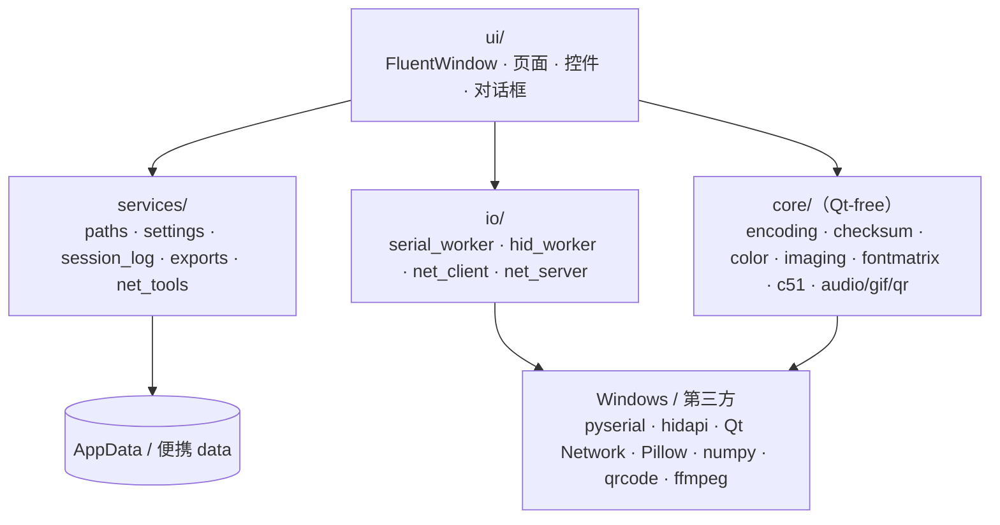
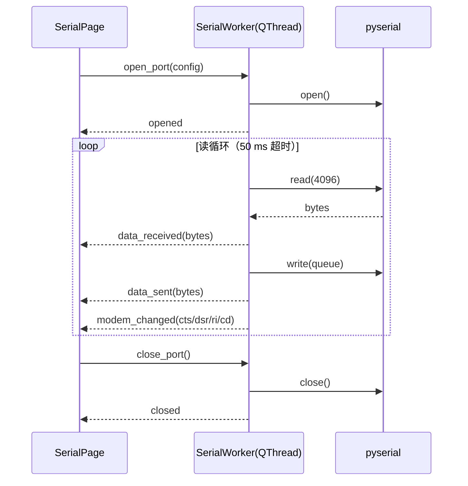

# 架构设计

本文描述 PortHelper Fluent 的分层、线程模型、数据流与扩展方式。面向维护者，不要求先读源码。

## 设计目标

1. **界面与协议解耦**：核心算法（校验、编码、图像、字模、C51）不导入 Qt，可在 pytest 中直接测试。
2. **IO 与 UI 解耦**：串口/HID 的阻塞读写放在 `QThread`；网络使用 Qt 事件循环；页面只消费信号。
3. **页面可替换**：主窗口只依赖 10 个页面的构造契约，页面内部可以独立演进。
4. **单文件交付**：PyInstaller onefile，不安装服务/驱动，不写注册表，不需要管理员权限。
5. **失败可读**：所有用户可见错误使用中文「发生了什么 + 可能原因 + 下一步」，技术细节写日志。

非目标：系统级串口驱动监视、厂商 DLL（CH372）、蓝牙助手、自动更新。

## 分层



| 层 | 职责 | 禁止 |
| --- | --- | --- |
| `app/core` | 纯算法、数据格式、配置模型、日志基础设施 | 导入 Qt、页面、IO |
| `app/services` | 路径、配置持久化、会话记录、导出、Ping/DNS/网卡 | 导入页面 |
| `app/io` | 串口/HID 工作线程、TCP/UDP 客户端、TCP 服务端 | 直接操作控件 |
| `app/ui` | 窗口、页面、控件、对话框、主题、反馈 | 在页面内实现协议/算法 |

> 已知偏差：`app/core/imaging.py` 与 `app/core/fontmatrix.py` 引用了 `app/services/exports.py` 的文件名/原子写入辅助函数。它们是 Qt-free 的，但严格来说 `core → services` 不是理想方向；后续可将这些纯文件工具下沉到 `core/files.py`。

## 模块地图

### core

| 模块 | 内容 |
| --- | --- |
| `settings.py` | 默认值、JSON 配置、损坏备份、原子保存、页面编码回退 |
| `logging_setup.py` | 轮转日志、崩溃报告、`sys`/`threading` 异常钩子 |
| `encoding.py` | HEX 解析、编码解析、进制转换、七段数码管、Bin/Hex/Text |
| `checksum.py` | 流式 Sum/XOR/奇偶/Intel HEX/TCP-IP、CRC-8/16/32 预设与自定义 |
| `color.py` | RGB888/RGB565/RGB332 编解码 |
| `imaging.py` | 图片→C/BIN/LVGL8/9、扫描/方向/位深/字节序/阈值、批量 |
| `fontmatrix.py` | 文字/BMP→点阵、分页、位序/走向、C 导出 |
| `c51.py` | 定时器/波特率/寄存器、警告、C 与 Keil 工程生成 |
| `audio_tools.py` | WAV/MP3 解码、时长、C 数组 |
| `gif_tools.py` | GIF 帧读取、BMP 导出 |
| `qr_tools.py` | 二维码生成/保存 |

### io

| 模块 | 内容 |
| --- | --- |
| `serial_worker.py` | `SerialTransport` 协议、pyserial 适配、`SerialWorker(QThread)`、端口枚举 |
| `hid_worker.py` | `HidBackend` 协议、hidapi 适配、`HidWorker(QThread)`、设备枚举 |
| `net_client.py` | `NetClientController(QObject)`，TCP/UDP、异步域名、状态/错误信号 |
| `net_server.py` | `NetServerController(QObject)`，监听、多客户端、广播、计数 |

### services

| 模块 | 内容 |
| --- | --- |
| `paths.py` | AppData/便携路径、可写探测、回退 |
| `exports.py` | 文件名清洗、唯一路径、原子写 |
| `session_log.py` | 记录、字节/条数上限、生命周期计数、TXT/CSV 导出 |
| `net_tools.py` | 系统 `ping.exe`、DNS、psutil 网卡信息、默认网关 |

### ui

| 模块 | 内容 |
| --- | --- |
| `main_window.py` | `FluentWindow`、分组导航、几何保存、关闭确认、图标 |
| `theme.py` | 浅色/深色/跟随系统、强调色、Mica 探测 |
| `qt_utils.py` | `safe_slot`、`readable_message`、`process_events_until`、Qt 消息处理器 |
| `feedback.py` | InfoBar、错误非模态退路 |
| `widgets/` | 日志面板、文件选择、HEX 输入、状态胶囊、卡片、矩阵视图 |
| `dialogs/` | 会话记录、多项发送、文本信息、自定义 CRC |
| `pages/` | 10 个页面；`convert/` 内含 7 个转换工具 |

## 线程与数据流

### 串口



- 写队列与 DTR/RTS/BREAK 命令都在工作线程顺序执行，避免 UI 线程直接碰串口句柄。
- 文件发送按 `data_sent` 确认推进：只有上一块真正写入后才读下一块，避免无界队列。
- 接收数据由 `LogPane` 接收，33 ms 批量刷新；暂停只停渲染，不停计数。

### 网络

- TCP 客户端：`QTcpSocket`；连接/断开/错误/数据都转成信号。
- UDP：`QUdpSocket`；数值 IP 直接发送，域名通过 `QHostInfo.lookupHost` 异步解析。
- 域名按主机排队，lookup ID 防止陈旧回调消费其他主机的数据；解析结果缓存 300 秒。
- TCP 服务端：`QTcpServer`，每个客户端一个 `QTcpSocket`；按客户端 ID 维护地址、连接时间、RX/TX 计数。
- 所有网络槽函数通过 `safe_slot` 兜底；错误消息区分拒绝、超时、DNS、端口占用、防火墙等。

### HID

- `HidWorker(QThread)` 读循环 50 ms 超时；发送队列；报告 ID 可选，报告长度按 1–1024 补齐/截断。
- 设备拔出或读写失败：发 `error`，关闭句柄，发 `closed`，页面自动复位。
- 仅支持标准 HID；CH372/CH375 需要厂商 DLL，不在支持范围。

### 日志

```text
IO 信号 → LogPane.append_bytes()
        → SessionLog.add()（生命周期计数、8 MB 上限）
        → pending deque
        → 33 ms QTimer 批量渲染（每次 2000 条/256 KB）
        → QPlainTextEdit（最多 20000 行）
```

- 超过会话上限时丢弃最旧记录；`LogPane` 显示「会话记录已截断」，TXT 导出带说明行。
- 显示区有上限，导出使用 `SessionLog` 的完整保留内容；CSV 使用 UTF-8 BOM。

## 配置与路径

| 项 | 默认 |
| --- | --- |
| 配置 | `%APPDATA%\PortHelperFluent\config.json` |
| 日志 | `%APPDATA%\PortHelperFluent\logs\app.log` |
| 崩溃报告 | `%APPDATA%\PortHelperFluent\logs\crash-*.txt` |
| 便携模式 | exe 同目录 `portable.flag` → `data\` |
| 便携写入失败 | 回退 AppData，显示中文警告 |
| 配置损坏 | 备份 `config.bad-*.json`，恢复默认 |
| 写入方式 | 临时文件 + `os.replace`，避免半截 JSON |

不写注册表，不安装服务/驱动，不请求管理员权限。

## 错误处理

- `safe_slot` 捕获所有 Qt 槽异常，写日志并显示 InfoBar/非模态错误框；PyQt6 不会因槽异常静默 abort。
- 启动失败：Qt 对话框 → 原生 `MessageBoxW` → 日志；`PORTHELPER_NO_DIALOGS=1` 用于无头测试。
- 所有窗口化异常写 `crash-*.txt`；Qt 消息处理器把 Qt 警告写入统一日志。
- 串口/网络/HID 错误都区分「未打开/被占用/对端断开/DNS/防火墙」并给出下一步建议。

## 打包

- `build/app.spec`：PyInstaller onefile、windowed、图标、版本信息、qfluentwidgets 资源、hidapi/qrcode/Pillow/numpy/psutil/pyserial。
- 排除 PyQt5、WebEngine、Quick/QML、3D、Multimedia、tkinter、matplotlib、scipy、pandas。
- 不使用 UPX；不请求管理员权限。
- `build/build.ps1`：测试 → 图标 → 打包 → 归档检查 → 临时目录 selftest/smoke → SHA/日志。
- 归档不包含 `analysis/`、`docs/`、`tests/`、`.git`。

## 扩展方式

### 新增页面

1. 在 `app/ui/pages/` 创建 `QWidget` 页面，设置稳定 `objectName`，实现 `has_active_work()`/`stop_workers()`。
2. 在 `app/ui/main_window.py` 的 `_PAGE_SPECS` 中注册路由、类、图标、导航文字。
3. 页面构造契约：`page(settings, paths, parent=self)`；需要注入依赖时使用关键字参数。
4. 通用逻辑放 `core`/`services`，不要复制到页面。

### 新增转换工具

1. 在 `app/ui/pages/convert/` 创建工具控件，暴露标题与可选设置保存方法。
2. 在 `convert/page.py` 的 `TOOL_CLASSES` 注册；选中项自动持久化到 `convert.last_tool`。
3. 纯算法放 `app/core/`，补充核心测试。

### 新增校验算法

1. 在 `app/core/checksum.py` 增加流式累加器与 `compute_all` 注册。
2. 用公开已知向量或独立参考实现验证，避免用同一公式自证。
3. 在 `checksum_page.py` 的预设列表中加入显示名。

## 已知技术债

- `image_page.py`、`dotmatrix_page.py`、`c51_page.py`、`net_client_page.py` 等文件 900–1200 行，后续可拆分为控制器 + 视图。
- 图片/点阵批量与音频解码仍在 GUI 线程；超大文件可能短暂卡顿。
- `core → services` 的文件工具引用需要下沉。
- 分栏比例、最近导出目录尚未全部记忆。
- 日志方向仅用 `[RX]/[TX]` 前缀区分，未做逐行颜色。
- 真实串口/HID/Keil 属手工验收，不在自动测试范围。

这些是维护性/性能债务，不影响当前功能正确性。
